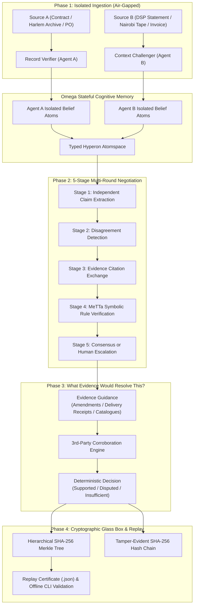

# ClearTrace Labs — Multi-Agent Truth & Reconciliation Engine

> **ClearTrace Labs — Evidence-Grounded Multi-Agent Document Discrepancy & Reconciliation Engine**  
> **Event:** *MeTTa & OMEGA: State of the Art Hackathon 2026*  
> **Track:** **Track 02: MeTTa Omega (Builders)**  
> **Challenges:** **Challenge 4: Two Agents, One Truth (Primary)** • **Challenge 2: The Agent That Grows Up** • **Challenge 1: The Glass Box Agent** • **Challenge 7: Trusted With Money**  
> **Engineering Lead:** Edwin Mwiti • **Architecture:** SingularityNET Hyperon / MeTTa & Omega Multi-Agent Cognitive Architecture  

[](LICENSE)
[-purple)](hackathon-starter/track-02-builders.md)
[](https://www.python.org/)
[](https://fastapi.tiangolo.com)
[](https://singularitynet.io)
[-brightgreen)](tests/)
[](scripts/validate_proof.py)

---

## 1. Executive Summary: What ClearTrace Labs Solves

Generative Large Language Models (LLMs) operate probabilistically: they optimize for token plausibility rather than verifiable ground truth. When presented with contradictory accounts or disputed figures—such as a Purchase Order stating 90 units vs. an Invoice billing 100, or a signed Split Sheet allocating 50% vs. a DSP remitting 35%—traditional chatbots invent synthetic compromises ("splitting the difference"), hallucinating intermediate dates, fabricated authors, or unverified financial settlements that distort reality.

**ClearTrace Labs** replaces ungrounded text generation with **deterministic symbolic deduction** and **structured multi-agent consensus**:

* **Phase 1 (Isolated Air-Gapped Intake)**: Agent A (*Record Verifier*) and Agent B (*Context Challenger*) ingest primary documents in complete air-gap isolation without seeing counterparty claims, preventing prompt contamination and early false convergence.
* **Phase 2 (5-Stage Cross-Challenge Negotiation)**: Agents debate claims across structured rounds, exchanging formal documentary citations rather than ungrounded chat tokens.
* **Phase 3 (MeTTa Reasoning in Typed Atomspace)**: SingularityNET Hyperon / MeTTa rewrite rules execute in a typed Atomspace, categorizing claims into `AGREEMENT`, `CONTRADICTION`, `SOURCE_EXCLUSIVE`, or `EVIDENCE_SUPPORTED`. Contradictions are explicitly preserved rather than guessed away.
* **Phase 4 (The Signature Differentiator: "What Could Help Resolve This?")**: Instead of stopping at the mismatch, ClearTrace guides the investigator with domain-specific recommendations of what missing proof could resolve the dispute, updating the outcome to *Supported*, *Still Disputed*, or *Insufficient Evidence*.
* **Phase 5 (Glass Box Integrity & Cryptographic Replay)**: Every case is sealed with a 6-layer **SHA-256 Merkle Tree** and appended to an unalterable audit chain, fully reproducible offline via our CLI.

---

## 2. Track 02 Challenge Alignment & Partner Creative Briefs

| Track 02 Challenge | Partner / Creative Brief | Real-World Problem Solved | Core MeTTa Implementation | Deterministic Verification Proof |
| :--- | :--- | :--- | :--- | :--- |
| **Challenge 4: Two Agents, One Truth** *(Primary)* | **AI for Peace** (Harlem ↔ Nairobi Oral History) | Reconciles conflicting community archives regarding the 1969 Cultural Peace Exchange. Preserves start date conflict (Aug 12 vs Aug 19) without synthetic hallucination until printed evidence corroborates Aug 12. | `peace_narrative.metta` | Contradiction preserved in Round 1–2; resolved to `1969-08-12` in Round 3 via neutral third-party programme corroboration. |
| **Challenge 2: The Agent That Grows Up** | **Incantio Music IP** (Creative Rights & Royalties) | Audits a creator's signed split sheet (50%) against a DSP streaming statement (35%). Starts with a small core rule set and visibly learns through our Rule Studio, showing live side-by-side rule diffs. | `incantio_rights.metta` + Dynamic Rule Synthesis (`/api/rules/custom`) | Live side-by-side diff: baseline strict dispute vs. newly synthesized 15% sub-publishing deduction waiver rule. |
| **Challenge 7: Trusted With Money** | **Harlem Fine Arts Show / Enterprise B2B** | Audits a 90-unit Purchase Order vs. 100-unit Invoice (KSh 5,000 variance). Locks out payment until an authorized PO amendment confirms delivery of 100 units. | `invoice_dispute.metta` | Exact financial variance calculated; locks payout until Amendment #PO-2026-089-AMD1 is cryptographically verified. |
| **Challenge 1: The Glass Box Agent** | **Enterprise Compliance & Audit** | Full transparent inspection: every claim, negotiation step, and verdict hash is exposed in our Hierarchical Merkle Tree and Atomspace Inspector. | Typed Atomspace (`/api/metta/space`) + Merkle DAG (`/api/cases/{id}/merkle-tree`) | Independent 1-line offline CLI replay verification: `python3 scripts/validate_proof.py --case-id={id}`. |

---

## 3. Cognitive Architecture & Multi-Agent Loop



---

## 4. Key Architectural Differentiators

1. **The Signature Feature: "What Evidence Would Resolve This?"**:
   When two documents disagree, standard tools stop at flagging a mismatch. ClearTrace analyzes the domain and property, recommends what specific document (such as a signed amendment, delivery note, or work registration ticket) would resolve the dispute, and dynamically updates the outcome when proof is attached.
2. **"The Agent That Grows Up" — Rule-Learning Studio**:
   Compliance officers can teach the system new MeTTa rewrite rules dynamically through the UI (`POST /api/rules/custom`). The Rule Studio renders a live side-by-side rule diff (Baseline strict dispute vs. Candidate synthesized rule) and immediately compiles the expression into the active Atomspace to re-evaluate cases in real time.
3. **Dual-Runtime MeTTa Engine (`backend/metta_runner.py`)**:
   Seamlessly interfaces with native C++ Hyperon when available, coupled with an embedded pure-symbolic MeTTa S-expression parser and reduction interpreter that executes declarative rewrite rules and logs step-by-step traces (`REWRITE_RULE_MATCH`, `CONDITION_EVAL`).
4. **Hierarchical Merkle Tree Visualizer (`backend/replay_service.py`)**:
   Constructs a 6-layer cryptographic Merkle DAG across sources, multi-agent negotiation rounds, and reconciled findings. External auditors can verify any case offline with zero cloud dependencies using:
   ```bash
   python3 scripts/validate_proof.py --case-id={CASE_ID}
   ```
5. **False-Consensus Guard**:
   Detects edge cases where both AI agents agree on a hallucinated extraction, rejecting false agent agreement in favor of deterministic source truth.

---

## 5. Quick Start (Clean-Clone Ready)

### Prerequisites
- Python 3.10+ (tested on Python 3.10, 3.11, 3.12, 3.14)
- Node.js 18+ and npm

### 1. Clone & Install Dependencies
```bash
git clone https://github.com/Edwin420s/SafeLedger.git
cd SafeLedger/cleartrace-labs

# Install Python backend dependencies
pip install -r requirements.txt

# Install React frontend dependencies
cd frontend && npm install && cd ..
```

### 2. Run the Full Automated Test Suite (33/33 Tests)
```bash
python3 -m pytest tests/ -v
```
*Executes all 33 unit and integration tests covering multi-agent negotiation, MeTTa Atomspace reduction, Merkle tree math, DoS protection, IDOR isolation, and proof validation.*

### 3. Start Backend Server
```bash
python3 -m uvicorn backend.main:app --host 0.0.0.0 --port 8000 --reload
```
*Interactive Swagger documentation available at: `http://localhost:8000/docs`*

### 4. Start React Frontend Dashboard
```bash
cd frontend
npm run dev -- --port 5173
```
*Open `http://localhost:5173` in your browser.*

### 5. Verify a Cryptographic Decision Proof via CLI
```bash
# Seed default demonstration benchmarks
python3 scripts/seed_presets.py

# Verify proof offline
python3 scripts/validate_proof.py --case-id=CT-B1534BBE
```

---

## 6. Project Structure

```
cleartrace-labs/
├── README.md                          # Master architectural overview & hackathon brief
├── AI_DISCLOSURE.md                   # Formal AI disclosure adhering to Hackathon Rule 3
├── DEMO_SCRIPT.md                     # 3-minute video walkthrough pitch script
├── DEPLOYMENT.md                      # Cloud & Docker production deployment guide
├── requirements.txt                   # Backend dependencies (fastapi, pydantic, pytest, httpx)
├── pytest.ini                         # Pytest configuration
├── LICENSE                            # Apache 2.0 open-source license
│
├── metta/                             # Symbolic Reasoning Substrate
│   ├── ontology/types.metta           # Typed atom schemas (Entity, Property, Value, Status)
│   └── rules/
│       ├── core_reconciliation.metta  # Mutual agreement, contradiction, and false-consensus rules
│       ├── peace_narrative.metta      # AI for Peace historical mediation rules
│       ├── incantio_rights.metta      # Royalty split & DSP statement rules
│       └── invoice_dispute.metta      # PO vs Invoice verification & amendment rules
│
├── backend/                           # Production FastAPI Server
│   ├── database.py                    # SQLite persistence & SHA-256 hash-chaining
│   ├── schemas.py                     # Pydantic v2 data models
│   ├── metta_runner.py                # Dual native/embedded MeTTa S-expression engine
│   ├── agents.py                      # Isolated Record Verifier (A) & Context Challenger (B)
│   ├── negotiation.py                 # 5-stage multi-round negotiation orchestrator
│   ├── replay_service.py              # SHA-256 Merkle tree & Replay Certificate generator
│   ├── presets.py                     # Synthetic demonstration datasets
│   └── main.py                        # REST API routing, lifespan, and export handlers
│
├── frontend/                          # React + Vite Production Dashboard
│   ├── src/
│   │   ├── App.jsx                    # Root coordinator & state manager
│   │   ├── data/scenarios.js          # Track 02 partner benchmarks & field dictionaries
│   │   └── components/
│   │       ├── Header.jsx             # Navigation tabs & multi-tenant user profile
│   │       ├── HeroBanner.jsx         # Track 02 Partner benchmark switcher
│   │       ├── DocumentInputs.jsx     # Action 1: Multi-document intake & supporting evidence
│   │       ├── FindingsSummary.jsx    # Action 2: "What could help resolve this?" & outcome cards
│   │       ├── NextSteps.jsx          # Action 3: Next steps, export, and auditor sign-off
│   │       ├── AdvancedAudit.jsx      # Action 4: Merkle Visualizer, Atomspace & Rule Studio
│   │       ├── SignOffModal.jsx       # Action 5: Accountable human-in-the-loop review form
│   │       ├── ReportModal.jsx        # Executive print & export preview modal
│   │       ├── AuditHistory.jsx       # Tenant-isolated searchable audit ledger
│   │       └── LandingPage.jsx        # Public product showcase
│
├── tests/                             # Automated Acceptance Test Suite (33/33 Passing)
│   ├── test_cleartrace.py             # MeTTa reasoning, multi-agent rounds & Merkle proofs
│   ├── test_auth_isolation.py         # Multi-tenant scoping & session security
│   └── test_security_resilience.py    # DoS protection, zip bombs, and recursion guards
│
└── scripts/                           # Tooling & Verification CLIs
    ├── validate_proof.py              # Standalone 1-line offline proof verification CLI
    ├── seed_presets.py                # Database seeder for demo cases
    ├── benchmark_engine.py            # Latency and throughput benchmark (>8,000 claims/sec)
    └── run_all_verifications.sh       # Unified verification runner
```

---

## 7. Team & Submission Information

* **Team Lead / Builder:** Edwin Mwiti (BASIX.MARKET Profile: Edwin Mwiti, Institution: Cleartrace Labs)
* **Track:** Track 02: MeTTa Omega (Builders)
* **Primary Challenge:** Challenge 4: Two Agents, One Truth
* **Secondary Challenges Addressed:** Challenge 2: The Agent That Grows Up • Challenge 1: The Glass Box Agent • Challenge 7: Trusted With Money
* **AI Disclosure:** Detailed in [`AI_DISCLOSURE.md`](AI_DISCLOSURE.md) adhering strictly to Hackathon Rule 3.
* **Demonstration Video Script:** Formatted in [`DEMO_SCRIPT.md`](DEMO_SCRIPT.md) for the 3-minute video presentation.
* **License:** [Apache 2.0](LICENSE).
