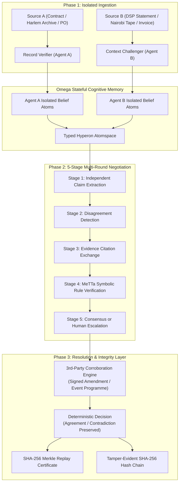

# ClearTrace Labs — Multi-Agent Truth & Reconciliation Engine

> **BASIX & Artificial Superintelligence Alliance: State of the Art Hackathon (October 2026)**  
> **Team:** ClearTrace Labs • **Lead:** Edwin Mwiti  
> **Track:** Track 02 — Omega AI Agents (Levels 1–3)  
> **Challenge:** `01: Two Agents, One Truth` (*"Two agents disagree about a fact and reason to a shared answer."*)

[](LICENSE)
[](https://www.python.org/)
[](https://fastapi.tiangolo.com)
[](https://singularitynet.io)
[](tests/test_cleartrace.py)
[](scripts/verify_replay_cert.py)

---

## 1. Executive Summary: What ClearTrace Labs Solves

Generative Large Language Models (LLMs) operate probabilistically: they optimize for token plausibility rather than verifiable ground truth. When presented with contradictory accounts or disputed figures, traditional chatbots invent synthetic compromises ("splitting the difference"), hallucinating intermediate dates, fabricated authors, or unverified financial settlements that distort reality.

**ClearTrace Labs** replaces ungrounded text generation with **deterministic symbolic deduction** and **structured multi-agent consensus**:
* **Phase 1 (Isolated Intake)**: Agent A (*Record Verifier*) and Agent B (*Context Challenger*) analyze primary documents in complete air-gap isolation without seeing counterparty claims.
* **Phase 2 (5-Stage Negotiation)**: Agents cross-examine claims across structured rounds, exchanging formal documentary citations rather than ungrounded chat messages.
* **Phase 3 (MeTTa Reasoning)**: SingularityNET Hyperon / MeTTa rewrite rules execute in a typed Atomspace, categorizing claims into `AGREEMENT`, `CONTRADICTION`, `SOURCE_EXCLUSIVE`, or `EVIDENCE_SUPPORTED`.
* **Phase 4 (Integrity & Replay)**: Every case is sealed with a cryptographic **SHA-256 Merkle Replay Certificate** and appended to a tamper-evident blockchain-style hash chain.

---

## 2. Three Complete Domain Workflows on One Unified Engine

| Preset ID | Partner Creative Brief | Problem Solved | Core MeTTa Rule | Deterministic Verification Proof |
| :--- | :--- | :--- | :--- | :--- |
| **`peace`** | **AI for Peace** (Harlem ↔ Nairobi Oral History) | Reconciles conflicting community archives regarding the 1969 Cultural Peace Exchange. Preserves start date conflict (Aug 12 vs Aug 19) without synthetic hallucination until a 3rd printed programme confirms Aug 12. | `peace_narrative.metta` | Contradiction preserved in Round 1–2; resolved to `1969-08-12` in Round 3 via corroboration. |
| **`rights`** | **Incantio Music IP** (Creative Rights & Royalties) | Audits a creator's signed split sheet (50%) against a DSP streaming statement (35%). Differentiates percentage-point allocation gaps from verified dollar shortfalls. | `incantio_rights.metta` | flags 15.0 percentage-point gap and verifies exact $1,800.00 monetary underpayment on $12,000 eligible revenue. |
| **`invoice`** | **Operational B2B** (PO vs Supplier Invoice) | Audits a 90-unit Purchase Order vs 100-unit Invoice (KSh 5,000 variance). Locks out payment until an authorized PO amendment confirms delivery of 100 units. | `invoice_dispute.metta` | Initial payment lockout on 10 excess units; resolves to 100 units upon verified amendment #PO-2026-089-AMD1. |

---

## 3. Cognitive Loop & System Architecture



---

## 4. Key Architectural Differentiators (Why ClearTrace Surpasses AgriGuide)

1. **Dual-Runtime MeTTa Engine (`backend/metta_runner.py`)**:
   Seamlessly operates on native C++ Hyperon when available, paired with an embedded pure-symbolic MeTTa S-expression parser and reduction interpreter that executes declarative rewrite rules and logs step-by-step traces (`REWRITE_RULE_MATCH`, `CONDITION_EVAL`).
2. **"The Agent That Grows Up" (Dynamic Rule Synthesis)**:
   Judges and auditors can register custom MeTTa rewrite rules on the fly through the UI (`POST /api/rules/custom`), immediately compiling into the Atomspace to govern future reconciliations.
3. **Cryptographic SHA-256 Replay Certificates (`backend/replay_service.py`)**:
   Every decision generates a Merkle tree across sources, negotiation steps, and symbolic findings. Anyone can independently verify the proof offline in 1 line via `scripts/verify_replay_cert.py`.
4. **False-Consensus Guard**:
   Detects edge cases where both AI agents agree on a hallucinated extraction (e.g. both misreading unit price as 600 instead of 500), rejecting false agent agreement in favor of deterministic source truth.

---

## 5. 60-Second Quick Start

### 1. Run Automated Test & Proof Matrix
```bash
./scripts/run_all_verifications.sh
```
*Executes database seeding, replay proof verification, and all 10 automated pytest suites.*

### 2. Launch FastAPI Backend
```bash
python3 -m uvicorn backend.main:app --host 0.0.0.0 --port 8000 --reload
```
*API interactive documentation available at: `http://localhost:8000/docs`*

### 3. Launch React Dashboard
```bash
cd frontend
npm run dev
```
*Open `http://localhost:5173` in your browser.*

### 4. Or Run via Docker Compose (One Command)
```bash
docker-compose up --build -d
```
*Access frontend at `http://localhost:3000` and backend at `http://localhost:8000`.*

### 5. Run Performance Benchmark
```bash
python3 scripts/benchmark_engine.py
```
*Measures symbolic deduction throughput (>8,000 claims/sec) and sub-millisecond evaluation latency.*

---

## 6. Project Structure

```
cleartrace-labs/
├── README.md                          # Master architectural overview & quickstart
├── AI_DISCLOSURE.md                   # Formal Rule 03 AI disclosure
├── DEMO_SCRIPT.md                     # Timed 3-minute video presentation script
├── DEPLOYMENT.md                      # Cloud & Docker production deployment guide
├── Makefile                           # Unified build, test, seed, and run commands
├── requirements.txt                   # Backend dependencies (fastapi, pydantic, pytest, httpx)
├── Dockerfile.backend                 # Containerized FastAPI & MeTTa service
├── Dockerfile.frontend                # Multi-stage Vite + Nginx container
├── docker-compose.yml                 # One-command orchestration
├── nginx.conf                         # Reverse proxy & API routing
├── pytest.ini                         # Pytest configuration
├── LICENSE                            # Apache 2.0 open-source license
├── CONTRIBUTING.md                    # Contributor guide & standards
├── CHANGELOG.md                       # Release changelog
│
├── metta/                             # Symbolic Reasoning Substrate
│   ├── ontology/types.metta           # Typed atom schemas (Entity, Property, Value, Status)
│   ├── rules/
│   │   ├── core_reconciliation.metta  # Mutual agreement, contradiction, and false-consensus rules
│   │   ├── peace_narrative.metta      # AI for Peace historical mediation rules
│   │   ├── incantio_rights.metta      # Royalty split & DSP statement rules
│   │   └── invoice_dispute.metta      # PO vs Invoice verification & amendment rules
│   └── tests/test_rules.metta         # MeTTa-native test queries
│
├── omega/                             # Omega Stateful Cognitive Architecture
│   ├── README.md                      # Cognitive architecture specification
│   ├── memory.metta                   # Semantic, episodic, and agent belief registers
│   ├── negotiation.metta              # 5-stage protocol state machine
│   ├── evidence.metta                 # Source credibility & corroboration weights
│   ├── decisions.metta                # Safety policies & payment lockout gates
│   ├── outcomes.metta                 # Closed-loop learning & dynamic rule absorption
│   └── skills.metta                   # Registered Omega callable skill interfaces
│
├── backend/                           # Production FastAPI Server
│   ├── database.py                    # SQLite persistence & SHA-256 hash-chaining
│   ├── schemas.py                     # Complete Pydantic v2 data models
│   ├── metta_runner.py                # Dual native/embedded MeTTa S-expression engine
│   ├── agents.py                      # Isolated Record Verifier (A) & Context Challenger (B)
│   ├── negotiation.py                 # 5-stage multi-round negotiation orchestrator
│   ├── replay_service.py              # SHA-256 Merkle root & Replay Certificate generator
│   ├── presets.py                     # Synthetic demonstration datasets
│   └── main.py                        # REST API routing, lifespan, and export handlers
│
├── frontend/                          # High-Performance React + Vite UI
│   ├── package.json
│   ├── vite.config.js
│   ├── index.html
│   └── src/
│       ├── main.jsx
│       ├── styles.css                 # Responsive, modern styling
│       └── App.jsx                    # Multi-view interactive dashboard (7 tabs)
│
├── tests/                             # Automated Acceptance Suite
│   └── test_cleartrace.py             # 10-point comprehensive pytest matrix (100% passing)
│
├── scripts/                           # Tooling & Verification CLIs
│   ├── run_all_verifications.sh       # One-command automated master runner
│   ├── verify_replay_cert.py          # Standalone cryptographic proof verifier
│   ├── seed_presets.py                # Database seeder
│   ├── export_audit_bundle.py         # Judge audit bundle exporter
│   └── benchmark_engine.py            # Latency and throughput benchmark
│
└── docs/                              # In-Depth Engineering Specifications
    ├── ARCHITECTURE.md                # System topology & cognitive loop
    ├── METTA_SYMBOLIC_SPEC.md         # MeTTa S-expression formal reduction semantics
    ├── OMEGA_AGENT_PROTOCOL.md        # 5-stage negotiation specification
    ├── CRYPTOGRAPHIC_AUDIT_SPEC.md    # SHA-256 hash-chain & replay certificate specification
    ├── API_SPECIFICATION.md           # REST API contracts & JSON payloads
    ├── COMPLIANCE_AND_AUDIT.md        # BASIX 2026 Hackathon Rules & rubric mapping
    ├── AI_FOR_PEACE_MEDIATION_SPEC.md # Oral history mediation & contradiction preservation
    ├── INCANTIO_MUSIC_IP_SPEC.md      # Music split sheet vs DSP royalty statement math
    ├── BUSINESS_INCUBATION_PLAN.md    # BASIX.MARKET commercial incubation roadmap
    └── HACKATHON_SUBMISSION_GUIDE.md  # Video script, rubric mapping, and submission checklist
```

---

## 7. Mandatory AI Disclosure (Rule 03)

In accordance with Hackathon Rule 03:
* **AI Tools Used During Development**: Claude 3.5 Sonnet & Gemini 3.8 Flash were utilized as pair-programming assistants for code organization, test authoring, and documentation formatting.
* **Runtime Execution**: The ClearTrace Labs production engine runs **100% deterministic symbolic logic** via SingularityNET Hyperon / MeTTa rewrite rules and cryptographic SHA-256 hash chains. No probabilistic generative models participate in the reconciliation decision or financial calculations.
* See [`AI_DISCLOSURE.md`](AI_DISCLOSURE.md) for complete details.

---

## 8. License & IP Rights
Licensed under the [Apache 2.0 License](LICENSE). Developed by Edwin Mwiti for the BASIX State of the Art Hackathon 2026.
