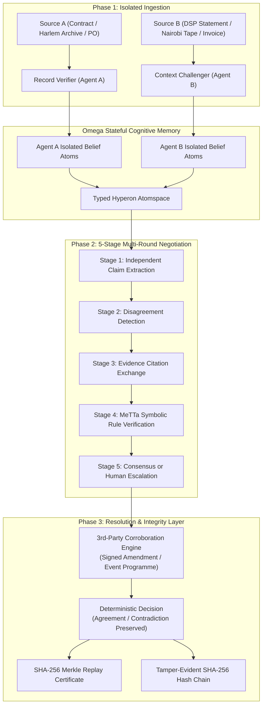

# ClearTrace Labs — Production Architecture & Cognitive Blueprint

## Executive Abstract
ClearTrace Labs is a deterministic, evidence-grounded multi-agent dispute resolution and truth engine built on **SingularityNET Hyperon / MeTTa** and the **Omega Stateful Agent Architecture**. Architected specifically for **Track 02 (Omega AI Agents) -> Challenge 01 (Two Agents, One Truth)** of the BASIX State of the Art Hackathon 2026, ClearTrace investigates situations where two autonomous AI agents reach conflicting conclusions about the same domain fact.

Rather than relying on ungrounded generative LLMs that invent synthetic compromises or "split the difference," ClearTrace implements genuine agent separation, structured 5-stage cross-examination, and declarative MeTTa S-expression deduction in a typed Atomspace.

---

## 1. High-Level System Architecture

---

## 2. Core Subsystems

### A. Phase 1: Isolated Intake
Agent A and Agent B operate under strict air-gap isolation during intake:
* **`RecordVerifierAgentA`**: Focuses on explicit contractual terms, living archive records, and formal purchase orders. Validates internal numerical ranges and structural integrity.
* **`ContextChallengerAgentB`**: Focuses on counterparty operational statements, eyewitness chronicles, and supplier invoices. Generates counter-hypotheses and requests documentation.
Neither agent has access to the other's source documents during extraction, preventing prompt contamination and false early convergence.

### B. Phase 2: The 5-Stage Negotiation Protocol
When canonical properties diverge, the `MultiAgentReconciliationEngine` executes a 5-stage protocol across up to 3 structured rounds:
1. **Stage 1 (Independent Assessment)**: Log initial claims and citations.
2. **Stage 2 (Disagreement Detection)**: Map raw properties to canonical properties and detect value deltas.
3. **Stage 3 (Evidence Challenge)**: Exchange formal documentary citations (`evidence_ref`) without subjective text generation.
4. **Stage 4 (Rule Verification)**: Evaluate MeTTa symbolic rewrite rules. If a 3rd-party independent archive is supplied, evaluate corroboration.
5. **Stage 5 (Resolution or Escalation)**: If uncorroborated, freeze the dispute in `CONTRADICTION` with zero hallucinated compromise and escalate to human review.

### C. Phase 3: Dual-Runtime MeTTa Engine
The backend integrates SingularityNET Hyperon via `backend/metta_runner.py`:
* **Native Hyperon Mode**: Executes queries directly against the C++/Python `hyperon.MeTTa` Atomspace when installed.
* **Pure-Symbolic Embedded Mode**: Full S-expression tokenizer, recursive descent parser, and reduction interpreter executing the exact same declarative rules and logging a complete step-by-step trace (`REWRITE_RULE_MATCH`, `CONDITION_EVAL`, `VARIABLE_BINDINGS`).

### D. Phase 4: Cryptographic Replay & Tamper-Evident Ledger
1. **SHA-256 Replay Certificates**: Computes an ordered Merkle root across all sources, negotiation steps, and rule findings, generating an unalterable proof string.
2. **Blockchain-Style Audit Chain**: Every case creation, extraction, rule reduction, and reviewer decision is linked via `curr_hash = SHA256(prev_hash + index + event_type + actor + details)`. Any database alteration is instantly detected.
3. **The Agent That Grows Up**: Auditors can register custom MeTTa rewrite rules dynamically (`POST /api/rules/custom`), which compile directly into the active Atomspace to govern future disputes.

### E. Phase 5: Hierarchical Merkle Tree Layer Engine
The `DecisionReplayService` builds an authenticated multi-level Merkle tree:
* **Level 0 (Leaf Hashes)**: Hashed atomic objects partitioned into sources, negotiation steps, and symbolic findings.
* **Level 1 to Level N-1**: Pairwise associative SHA-256 reductions.
* **Level N (Merkle Root)**: Top-level cryptographic root sealing the entire decision history.
Exposed via `GET /api/cases/{case_id}/merkle-tree` and visualized interactively in the web dashboard.

### F. Phase 6: Automated Unstructured Text Extraction
`RecordVerifierAgentA` and `ContextChallengerAgentB` feature heuristic fallback parsers (`extract_claims_from_raw_text`) that automatically detect and tokenize dates, percentages, monetary amounts, and participant estimates from raw, unformatted documents, supporting ad-hoc reconciliation across custom domains (ESG carbon disclosures, clinical trials, legal contract amendments).

### G. Phase 7: Dual-Mode User Experience & Responsible Trust Taxonomy
The frontend separates operational consumption from forensic compliance:
* **Simple Mode (Default)**: Designed around the core user objective—*"I have two documents; show me what differs, why it matters, and what to do next."* Implemented across three numbered actions:
  1. *Action 1 (Add Your Documents)*: Two primary textareas, presets, clear confirmation, and an expandable 3rd-party independent evidence panel.
  2. *Action 2 (Understand the Results)*: Plain-language summary banner, prioritized discrepancy cards, side-by-side claim values with exact citations, and financial impact exposure estimates.
  3. *Action 3 (Next Steps for Your Audit)*: Concrete operational options to add independent proof, record human approval, or export reports.
* **Advanced Audit Mode**: Tailored for hackathon judges, auditors, and systems engineers. Exposes the multi-agent negotiation timeline, human reviewer adjudication ledger, and offline mathematical SHA-256 Decision Replay validation.
* **Responsible Trust Categorization**:
  * `Agreement Between Sources`: Both records state the same value. Distinct from independent verification—shared claims do not constitute external truth.
  * `Conflict Detected`: Records state conflicting values. Preserved transparently without hallucinating averages.
  * `Supported by Independent Evidence`: Reserved exclusively for claims corroborated by an independent third document.
  * `Document-Exclusive Note`: Asymmetric claims documented in one source only.

