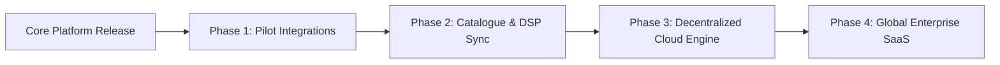

# ClearTrace Labs — Enterprise Commercialization & Scaling Roadmap

**Platform**: ClearTrace Labs  
**Engineering Lead**: Edwin Mwiti  
**Architecture Substrate**: SingularityNET Hyperon / MeTTa & Omega Multi-Agent Architecture  

---

## 1. Executive Summary

ClearTrace Labs is an enterprise-grade, deterministic multi-agent document reconciliation engine powered by SingularityNET Hyperon / MeTTa. It solves the critical vulnerability in generative AI document processing: **probabilistic hallucination of false compromise**.

ClearTrace Labs proves that two AI agents holding conflicting beliefs can independently extract evidence, negotiate across structured protocol rounds, and arrive at a mathematically and historically sound resolution—or explicitly preserve the disagreement under cryptographic SHA-256 Merkle proofs.

---

## 2. Target Enterprise Verticals

| Vertical | Market Challenge | ClearTrace Labs Solution |
| :--- | :--- | :--- |
| **Creative IP & Music Licensing** | Co-writers and DSP statements diverge; millions in royalties lost to "black box" publisher splits. | Automated split sheet vs DSP statement audit with exact percentage-point and dollar underpayment flags. |
| **Cultural Heritage & Archives** | Multiple oral histories are either flattened by biased curation or hallucinatory LLMs. | Attribution-preserving narrative mediation with third-party archival corroboration. |
| **Supply Chain & B2B Invoicing** | Purchase orders, shipping manifests, and vendor invoices misalign, delaying payments. | Deterministic variance detection and PO amendment verification with SHA-256 tamper-evident logs. |
| **Decentralized Oracles & RWAs** | Oracles blindly average conflicting data feeds, poisoning smart contract settlements. | Truth reconciliation engine that rejects false agent consensus and requires source corroboration. |

---

## 3. Commercial Architecture & Deployment Models

### A. SaaS Verification API (B2B)
- **Pay-Per-Reconciliation**: Micro-billing via x402 / AgentCash protocols or fiat subscription tiers ($0.05 per claim verification).
- **Enterprise SLA**: On-premise Docker deployment with custom MeTTa domain rulesets for audit firms and licensing agencies.

### B. Provable Real-World Asset (RWA) Infrastructure
- **Provenance Ledger**: High-value assets receive a ClearTrace Replay Certificate linking specifications, co-creator shares, and document hashes.
- **Smart Contract Oracle Settlement**: ClearTrace emits verified SHA-256 Merkle roots that trigger escrow release only when `overall_status == 'CONSENSUS_REACHED'`.

---

## 4. Product Scaling Roadmap (2026 – 2027)

### Phase 1: Pilot Integrations
- Deploy persistent PostgreSQL + MeTTa Hyperon cluster in cloud environments.
- Onboard initial enterprise procurement teams to automate Purchase Order vs Invoice matching.

### Phase 2: Catalogue & DSP Sync Pilot
- Connect live API feeds from music publishing catalogues to audit independent artist split sheets.
- Automated quarterly DSP statement reconciliation.

### Phase 3: Decentralized Cloud Engine Release
- Publish the ClearTrace MeTTa engine as an accessible AI Service on the SingularityNET Marketplace.
- Support tokenized micropayments for running multi-agent truth verifications.

### Phase 4: Full Enterprise SaaS
- Multi-region SOC-2 certified deployment with automated dispute escalation workflows.
- Pre-built enterprise connectors for SAP, NetSuite, and Workday procurement pipelines.

---

## 5. Team & Engineering Governance
- **Edwin Mwiti**: System Architecture, MeTTa Symbolic Logic, Full-Stack Engineering.
- **Engineering Advisory**: SingularityNET Community Mentors, Distributed Systems Experts.
