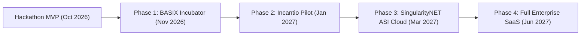

# ClearTrace Labs — Commercial Incubation Plan & Roadmap

**Hackathon Context**: BASIX State of the Art Hackathon 2026 (Track 02: Omega AI Agents)  
**Target Incubation Platform**: [BASIX.MARKET](https://basix.market)  
**Lead Builder**: Edwin Mwiti  

---

## 1. Executive Summary

ClearTrace Labs is an enterprise-grade, deterministic multi-agent reconciliation engine powered by SingularityNET Hyperon / MeTTa. It solves the critical vulnerability in today's generative AI: **probabilistic hallucination of false compromise**.

ClearTrace Labs proves that two AI agents holding conflicting beliefs can independently extract evidence, negotiate across structured protocol rounds, and arrive at a mathematically and historically sound resolution—or explicitly preserve the disagreement under cryptographic SHA-256 Merkle proofs.

---

## 2. Product-Market Fit & Target Verticals

| Vertical | Market Pain Point | ClearTrace Labs Solution |
| :--- | :--- | :--- |
| **Creative IP & Music Licensing (Incantio / BASIX)** | Co-writers and DSP statements diverge; millions in royalties lost to "black box" publisher splits. | Automated split sheet vs DSP statement audit with exact percentage-point and dollar underpayment flags. |
| **Cultural Heritage & Archives (AI for Peace / HFAS)** | Multiple oral histories are either flattened by biased curation or hallucinatory LLMs. | Attribution-preserving narrative mediation with third-party archival corroboration. |
| **Supply Chain & B2B Invoicing (Enterprise)** | Purchase orders, shipping manifests, and vendor invoices misalign, delaying payments. | Deterministic variance detection and PO amendment verification with SHA-256 tamper-evident logs. |
| **Decentralized Oracles & RWAs** | Oracles blindly average conflicting data feeds, poisoning smart contract settlements. | Truth reconciliation engine that rejects false agent consensus and requires source corroboration. |

---

## 3. Commercial Architecture & Monetization

### A. SaaS Verification API (B2B)
- **Pay-Per-Reconciliation**: Micro-billing via x402 / AgentCash protocols or fiat subscription tiers ($0.05 per claim verification).
- **Enterprise SLA**: On-premise Docker deployment with custom MeTTa domain rulesets for audit firms and licensing agencies.

### B. BASIX.MARKET RWA & IP Infrastructure
- **Phigital Provenance Ledger**: Every artwork registered on BASIX.MARKET receives a ClearTrace Replay Certificate linking artist statements, co-creator shares, and image hashes.
- **Smart Contract Oracle Settlement**: ClearTrace emits verified SHA-256 Merkle roots that trigger escrow release only when `overall_status == 'CONSENSUS_REACHED'`.

---

## 4. Post-Hackathon Incubation Roadmap (Q4 2026 – Q2 2027)

### Phase 1: BASIX Incubator Onboarding (Nov 2026)
- Integrate ClearTrace Labs directly into the BASIX Dev LMS and Job Board infrastructure.
- Formalize rights-sharing agreement with BASIX.MARKET per Rule 10 terms.
- Deploy persistent PostgreSQL + MeTTa Hyperon cluster on AWS / Fly.io (Nairobi Region).

### Phase 2: Incantio Sync Licensing Pilot (Jan 2027)
- Connect live API feeds from Incantio.com catalogue to audit 500+ independent artist split sheets.
- Automated quarterly DSP statement reconciliation.

### Phase 3: SingularityNET ASI Cloud Release (Mar 2027)
- Publish the ClearTrace MeTTa engine as an accessible AI Service on the SingularityNET Marketplace.
- Accept AGIX token payments for running multi-agent truth verifications.

---

## 5. Team & Governance
- **Edwin Mwiti**: System Architecture, MeTTa Symbolic Logic, Full-Stack Engineering.
- **Ecosystem Collaborators**: SingularityNET Mentors, XR Agency, BGI Comms, Incantio.com.
