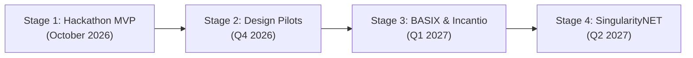

# ClearTrace Labs — Business Model, Market Opportunity & Commercial Strategy
### For Investors, Business Leaders, Evaluators, and Incubators

> *"When records disagree, make the next decision clear. Turn disputes from cost centers into accountable clarity."*

---

## 1. Executive Summary

Every year, organizations lose billions of dollars to conflicting records:
* **Procurement teams** pay unverified invoices because cross-referencing Purchase Orders, Goods Received Notes, and amendments takes too much manual time.
* **Music publishers and creators** lose 10%–25% of their rightful royalties to unverified DSP streaming deductions and misattributed split sheets.
* **Operations and legal teams** spend weeks in email arguments over which contract version or amendment governs a deal.

Existing solutions fall into two flawed extremes:
1. **Basic document diff tools** (e.g. Diffchecker) show that text differs, but cannot tell you *what the difference means*, *what money is at risk*, or *what proof would resolve it*.
2. **Generative AI chatbots** (e.g. ChatGPT, Claude) hallucinate false compromises, guess intermediate figures, or fabricate justifications, creating immense legal and financial liability.

**ClearTrace Labs** introduces an **evidence-first investigation workspace**. Powered by SingularityNET MeTTa symbolic logic and Omega multi-agent memory, ClearTrace isolates conflicting statements, calculates exact financial exposure down to the dollar/shilling, provides targeted recommendations for what evidence is missing, and seals the final human decision in an unalterable cryptographic Merkle proof.

---

## 2. Market Sizing & The Discrepancy Cost

| Market Vertical | Annual Friction & Loss | Current Industry Pain Point |
| :--- | :--- | :--- |
| **B2B Accounts Payable & Procurement** | **$14.2 Billion** globally in overbilling, duplicate invoices, and manual reconciliation overhead. | Over 3.6% of supplier invoices contain quantity, rate, or unit mismatches against authorized POs. Average cost to resolve a single disputed invoice: **$54** and **4 to 6 business days**. |
| **Music Rights & Streaming Royalties** | **$2.5+ Billion** in unallocated or contested "black box" streaming royalties worldwide. | Co-writer split sheets signed in recording sessions conflict with quarterly DSP distribution statements; creators lack forensic tools to challenge DSP deductions. |
| **Contract Operations & Logistics** | **$11.8 Billion** in delayed settlements, shipping demurrage, and contract breach claims. | Conflicting amendments, bills of lading, and delivery schedules delay enterprise cash flow and trigger avoidable litigation. |

---

## 3. Product Differentiation: Why ClearTrace Wins

```
┌─────────────────────────────────┬───────────────────┬──────────────────┬──────────────────────┐
│ Capability                      │ Generic LLMs      │ Document Diffs   │ ClearTrace Labs      │
│                                 │ (ChatGPT, Claude) │ (Diffchecker)    │ (Evidence-First)     │
├─────────────────────────────────┼───────────────────┼──────────────────┼──────────────────────┤
│ Hallucination-Free Deduction    │ ❌ Guesses/Averages│ ❌ No semantic AI│ ✅ 100% Deterministic│
│ Air-Gapped Ingestion            │ ❌ Same Prompt    │ ❌ None          │ ✅ Isolated Agents   │
│ Financial Exposure Math         │ ⚠️ Probabilistic  │ ❌ None          │ ✅ Exact Invariant   │
│ "What Could Help Resolve This?" │ ❌ Generic Prompt │ ❌ None          │ ✅ Domain Guidance   │
│ Preserved Contradictions        │ ❌ Blurs Conflict │ ❌ Raw red/green │ ✅ Explicit Status   │
│ Cryptographic Offline Proof     │ ❌ Impossible     │ ❌ None          │ ✅ SHA-256 Merkle DAG│
│ Dynamic Rule Learning Studio    │ ❌ Prompt Hack    │ ❌ None          │ ✅ MeTTa Atomspace   │
│ Multi-Tenant Isolation          │ ⚠️ Public Cloud   │ ⚠️ Cloud Upload  │ ✅ Air-Gapped DB     │
└─────────────────────────────────┴───────────────────┴──────────────────┴──────────────────────┘
```

---

## 4. Customer Segments & Ideal Customer Profiles (ICPs)

### Segment A: B2B Procurement & Accounts Payable Operations
* **Primary Buyer:** Head of Procurement, VP of Finance, or Accounts Payable Controller.
* **Pain Point:** Mismatches between Purchase Orders, Goods Received Notes (GRNs), and Vendor Invoices delay close-of-month and cause cash leakages.
* **Value Metric:** Reduces average invoice dispute resolution time from **5 days to under 3 minutes**; catches 100% of unapproved quantity or price inflations.

### Segment B: Music Publishing, Sync Licensing & Creator Platforms
* **Primary Buyer:** Rights Administrator, Catalog Manager, or Independent Creator Collective.
* **Pain Point:** Signed split sheets (e.g. 50%/50%) diverge from DSP statements (e.g. 35%), with streaming leakage across foreign territories.
* **Value Metric:** Recovers an average of **$1,200 to $4,500 per contested catalog track**; automates pre-listing verification for licensing platforms like [Incantio.com](https://incantio.com).

### Segment C: Contract Management & Regulatory Compliance
* **Primary Buyer:** General Counsel, Chief Compliance Officer, or Operations Director.
* **Pain Point:** Tracking multiple addenda, terms amendments, and governing law disclosures across multi-entity contracts.
* **Value Metric:** Produces court-ready, tamper-evident SHA-256 audit reports proving exactly how and when each clause was verified.

---

## 5. Commercial Packaging & Pricing Strategy

ClearTrace Labs employs a value-based SaaS subscription model supplemented by high-volume API micropayments:

```
┌───────────────────────────┬───────────────────────────┬───────────────────────────┐
│        TEAM TIER          │       BUSINESS TIER       │      ENTERPRISE TIER      │
│         $99 / mo          │         $499 / mo         │       $2,499+ / mo        │
├───────────────────────────┼───────────────────────────┼───────────────────────────┤
│ • Up to 50 cases / month  │ • Up to 500 cases / month │ • Unlimited cases / month │
│ • 3 team member seats     │ • 15 team member seats    │ • Unlimited seats         │
│ • Air-gapped intake       │ • Custom Rule Studio      │ • Dedicated container SLA │
│ • Executive PDF reports   │ • Financial exposure calc │ • ERP Connectors (SAP, NS)│
│ • Offline CLI validation  │ • Merkle DAG Inspector    │ • SOC2 Type II compliance │
│ • Standard support        │ • Priority support        │ • Custom MeTTa ontologies │
└───────────────────────────┴───────────────────────────┴───────────────────────────┘
```

### High-Volume Pay-Per-Verification API (Web3 & Micro-Billing)
* **Price:** **$0.05 per claim verification** via standard Stripe billing or decentralized micropayments (x402 / AgentCash USDC rails).
* **Use Case:** Automated background verification for marketplace platforms, smart contract oracles, and invoice automation pipelines.

---

## 6. Unit Economics & Customer ROI Calculation

Consider a mid-sized enterprise handling **400 vendor invoices per month**:
* **Baseline Cost without ClearTrace:**
  * ~5% of invoices (20 cases) encounter mismatches.
  * Average investigation time: 4 hours per case (spreadsheets, supplier emails, phone calls).
  * 20 cases × 4 hours × $45/hr internal labor = **$3,600 / month in investigation overhead**.
  * Undetected overpayment leakage: estimated ~1% of invoice volume = **$4,000 / month**.
  * **Total Monthly Dispute Cost: $7,600**.
* **With ClearTrace Labs (Business Tier at $499/mo):**
  * Automated claim extraction and discrepancy detection reduces investigation time to 15 minutes per case.
  * Total investigation time: 20 cases × 0.25 hours × $45/hr = **$225 / month**.
  * Zero undetected overpayments (hard physical & financial lockout).
  * Net monthly savings: **$7,600 - ($499 + $225) = $6,876 per month**.
  * **Annual Customer ROI: > 1,300% (Payback period < 20 days).**

---

## 7. Go-To-Market & BASIX.MARKET Incubation Roadmap



### Stage 1: Hackathon MVP & Digital IP (Current)
* Deliver working production repository with 33/33 tests passing.
* Verify 3 partner domain workflows: B2B Procurement, Incantio Music Rights, and AI for Peace.
* Deploy live containerized demonstration on Render / Railway with free-tier access.

### Stage 2: Design Partners & Pilot Validation (Q4 2026)
* Onboard 3–5 design partner businesses (2 creative rights agencies, 2 procurement teams, 1 archival organization).
* Measure baseline resolution times and user feedback.
* Package standard ERP and CSV export templates.

### Stage 3: BASIX.MARKET & Partner Production Deployment (Q1 2027)
* Formally execute co-ownership and incubation agreement with BASIX.MARKET under Rule 10.
* Integrate ClearTrace verification directly into the BASIX NFT Marketplace for phigital art editions and Incantio sync licensing catalogues.
* Lock out NFT minting and smart contract payouts until a 100% cryptographic Merkle proof is recorded.

### Stage 4: Decentralized AI Service on SingularityNET (Q2 2027)
* Publish the ClearTrace MeTTa engine as an autonomous AI service on the SingularityNET Marketplace.
* Support decentralized escrow settlement where on-chain smart contracts release funds automatically upon cryptographic MeTTa verification.
