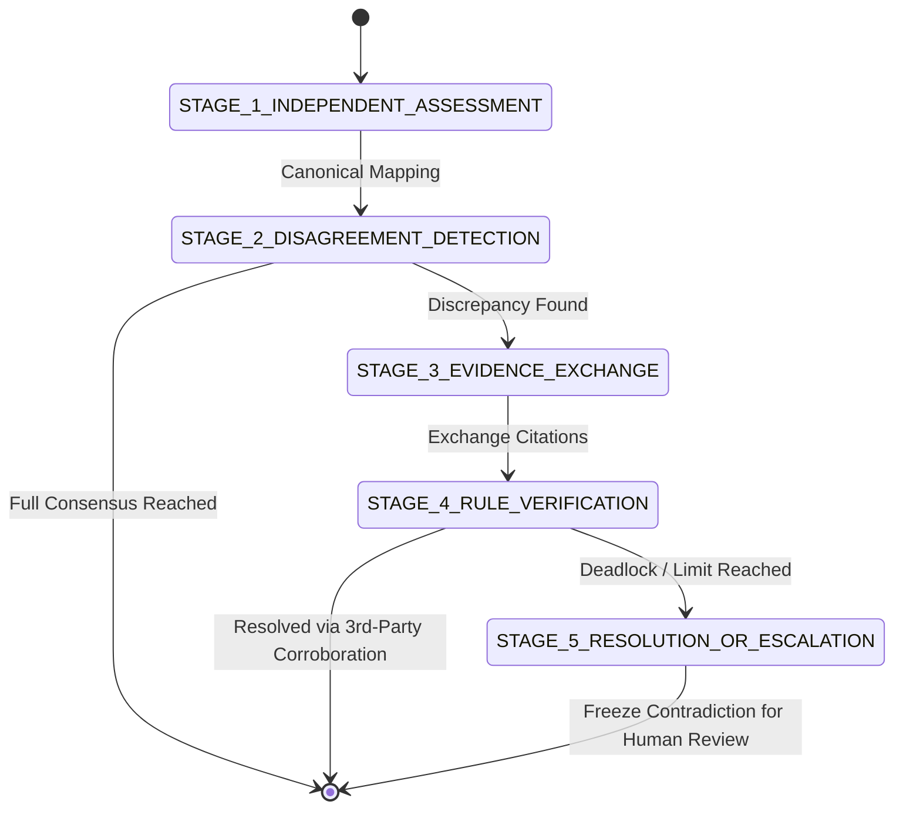

# ClearTrace Labs — Omega 5-Stage Multi-Round Negotiation Protocol

## Overview
The Omega Multi-Agent Protocol coordinates communication between **Agent A (Record Verifier)** and **Agent B (Context Challenger)** without allowing unrestricted natural-language chatting to produce hallucinated compromises.

---

## The 5 Protocol Stages

### Stage 1: Independent Assessment
* **Agent A**: Ingests Source A in isolation. Extracts formal contractual/record terms.
* **Agent B**: Ingests Source B in isolation. Extracts operational/eyewitness terms.
* Neither agent sees the other's extractions during this stage.

### Stage 2: Disagreement Detection
* The engine maps raw extracted properties into canonical property keys (e.g. `start_date`, `date` $\to$ `event_date`).
* Detects exact agreement, value discrepancy, or source asymmetry (claim present in one source but omitted in the other).

### Stage 3: Evidence Exchange & Challenge
* **Agent A**: Challenges discrepancies by citing specific lines, clauses, or paragraph references in Source A.
* **Agent B**: Responds with counter-citations from Source B and requests corroborating records or authorized amendments.

### Stage 4: Rule-Based Verification & Corroboration
* Evaluates declarative MeTTa rewrite rules.
* If an independent 3rd-party source (e.g., event programme, signed PO amendment) is available, its values are matched against the disputing positions.
* If corroborated, the diverging agent formally logs a `POSITION_REVISED` step and adopts the verified fact.

### Stage 5: Resolution or Escalation
* If the dispute cannot be settled with verifiable evidence, the engine halts negotiation, logs a `HALT_PRESERVE_DISPUTE` step, and transitions the case to `NEEDS_HUMAN_REVIEW`.
* Zero ungrounded or synthetic compromise is permitted.

<!-- Protocol enforces 5 distinct negotiation states without loop deadlocks. -->
