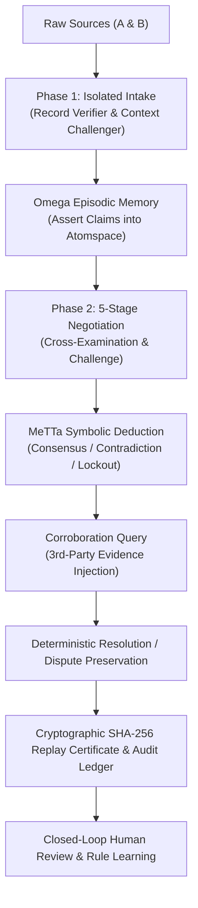

# ClearTrace Labs — Omega Cognitive Architecture

## Overview
ClearTrace Labs implements an evidence-grounded, multi-agent cognitive architecture based on SingularityNET's Omega principles:
> *"Generative AI guesses. MeTTa reasons. Omega remembers and shows its work."*

Traditional LLM summarizers lack stateful memory and deterministic dispute-handling protocols. When presented with contradictory accounts, they invent intermediate compromises ("splitting the difference"), which destroys historical accuracy in cultural archives and produces unauthorized payments in financial audits.

ClearTrace Labs addresses this through a five-stage stateful cognitive loop that preserves dispute integrity and maintains an unbroken chain of custody.

---

## The Cognitive Loop

---

## Subsystem Specifications

### 1. `memory.metta`
- **Semantic Memory**: Domain ontologies, property canonical mappings, and zero-tolerance financial discrepancy thresholds.
- **Episodic Memory**: Full audit trail of every claim, counter-claim, and concession across negotiation rounds.
- **Belief State Register**: Current working position of Agent A and Agent B per property.
- **Dispute Register**: Preserves unresolved contradictions without synthetic smoothing.

### 2. `negotiation.metta`
- Implements the 5-stage state machine:
  1. `STAGE_1_INDEPENDENT_ASSESSMENT`
  2. `STAGE_2_DISAGREEMENT_DETECTION`
  3. `STAGE_3_EVIDENCE_EXCHANGE`
  4. `STAGE_4_RULE_VERIFICATION`
  5. `STAGE_5_RESOLUTION_OR_ESCALATION`
- Deadlock detection and round termination guards.

### 3. `evidence.metta`
- Multi-tier credibility grading (primary contracts, institutional archives, third-party corroborators, oral history tapes).
- Joint provenance scoring for corroborated claims.

### 4. `decisions.metta`
- **Safety Policy 01**: Prohibits synthetic compromise when historical dates conflict.
- **Safety Policy 02**: Hard payment lockout when invoice quantities exceed purchase orders without signed amendments.
- **Safety Policy 03**: Mandatory human review escalation for unresolved disputes.

### 5. `outcomes.metta`
- Closed-loop auditor feedback absorption.
- Dynamic rule registration ("The Agent That Grows Up") allowing human experts to inject custom MeTTa rewrite rules that immediately govern future reconciliations.

### 6. `skills.metta`
- Registered Omega callable skill interfaces: `IngestSourceClaim`, `ChallengeAssumption`, `QueryCorroboration`, `FormulateConsensus`, `GenerateReplayProof`.
